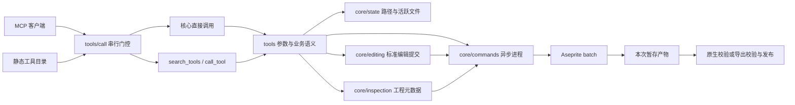

# 开发者文档

本项目将 MCP 调用转换为 Aseprite batch Lua／CLI，以原生工程作为编辑状态。每次执行启动新的 Aseprite 进程；层、帧等编辑目标由工具参数明确指定。

## 架构与数据流



`tools/` 依赖 `core/`。`core/commands.py` 管理进程与 UTF-8 输出，`core/lua.py` 承载共享目标、坐标和 cel 快照规则，`core/editing.py` 管理原生保存与提交，`core/native.py` 为原生命令激活显式目标。`core/inspection.py` 提供工程元数据读取，供查询和导出共享。字体栅格化在 `core/fonts.py`。

一次编辑先解析文件和参数，再生成 Lua，在临时原生文件保存成功后替换目标。进程层只判断执行状态，编辑层和导出层分别验证工程和图像。工具成功返回文本或 JSON 字符串；预期失败抛 `ToolError`，SDK 转换为 `isError=true`。

图像通过磁盘路径交付。Java Edition 工具另外返回会话临时的 8× PNG 路径，lifespan 在会话退出时清理它。

## 注册与新增工具

`aseprite_mcp/__init__.py` 的 `create_server()` 读取根 SKILL，构建 SDK 工具描述，安装 lifespan 与 middleware；`__main__.py` 创建后启动 stdio。工具 implementation 不依赖 server，import 不注册工具。

[`tool_catalog.py`](../aseprite_mcp/tool_catalog.py) 的字面量目录是核心／扩展归属及顺序的唯一来源。新增工具须明确加入对应目录，重名或无效符号在装配时失败。核心及固定发现入口直接公开；扩展通过 [`tool_discovery.py`](../aseprite_mcp/tool_discovery.py) 的 `search_tools`／`call_tool` 发现和执行。

搜索返回扩展的完整 SDK schema、类别与说明，支持分词匹配、类别浏览和分页；结果同时提供可读 JSON 文本。代理使用 SDK 描述校验、补默认值和执行，保留 content、structuredContent 与 isError。外层 tools/call 持有一次串行锁，目标复用请求上下文。公开工具集合在搜索、调用与重连前后保持稳定。

工具参考从同一目录与函数 AST 生成，标注直接或代理调用。客户端使用方式见 [本地开发与接入](development.md#客户端配置)。

新增编辑工具应遵循这些接口：

```python
filename = prepare_filename(filename)
# 用户字符串先 lua_escape；像素字典中的坐标先 parse_pixel_xy。
# Lua 用 EDIT_TARGET 明确目标，用 app.transaction 编辑，以 save_project(spr) 保存。
await execute_edit_script(script, filename)
return "编辑完成"
```

读取用 `await AsepriteCommand.execute_lua_script_checked(...)`，直接 CLI 用 `await AsepriteCommand.run_command(...)`。输出路径使用 `prepare_filename(path, must_exist=False, anchor=False)`。完整参数写入 Google 风格 docstring，供参考生成器解析。

修改工具后同步运行指令 [SKILL.md](../SKILL.md)，生成并检查 [工具参考](reference/tools.md)，运行受影响场景。标准工具失败由异常表达，测试检查具体内容与产物。

## 文档地图

| 文档 | 职责 |
|---|---|
| [01 · Lua 桥](01-lua-bridge.md) | 异步执行、stdout、共享 Lua、原生命令 |
| [02 · 路径、错误与生命周期](02-paths-errors-lifecycle.md) | 路径、ToolError、取消、门控与清理 |
| [03 · 绘图与像素编辑](03-painting.md) | 图元、网格、坐标、字体、区域与配色 |
| [04 · 画布与图层](04-layers-and-canvas.md) | 原生工程、图层树与跨文件复制 |
| [05 · 动画](05-animation.md) | cel／frame／tag 与复制规则 |
| [06 · 特效与 tilemap](06-effects-and-tilemap.md) | 原生滤镜、抖动、slice 与瓦片 |
| [07 · 导出与预览](07-output.md) | 隔离生成、精确发布与 JE 交付 |
| [08 · 读取与质量校验](08-inspection-and-quality.md) | 可见合成、统计与结构校验 |
| [本地开发与验证](development.md) | 环境、跨客户端配置、依赖与独立测试 |
| [工具参考](reference/tools.md) | 从源码签名生成的接口 |

sprite 是工程；cel 是图层与帧交点的图像，带位置、不透明度与 zIndex；没有 cel 表示该层该帧为空。外部帧号从 1 开始，sprite-global 坐标以画布左上角为原点。tag 指定帧区间和播放方向；tilemap 的 cel 保存瓦片索引。
