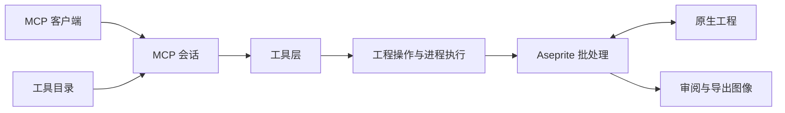

# 运行架构

Python 服务负责 MCP 会话、工具编排和文件发布。Aseprite 批处理负责打开、渲染和保存原生工程。批处理进程按执行启动，工程内容通过文件延续。

## 模块职责

| 模块 | 职责 | 源码 |
| --- | --- | --- |
| 服务装配 | 从目录装配核心工具和扩展发现入口，加载运行指令，管理会话调度与退出。 | [服务入口](../aseprite_mcp/__init__.py) · [工具目录](../aseprite_mcp/tool_catalog.py) |
| 工具层 | 将画布、像素、动画、审阅和导出的业务意图转换为工程操作，再组织领域结果。 | [tools/](../aseprite_mcp/tools) |
| 核心模块 | 提供输入与结果契约、活跃工程、目标定位、原生提交、进程执行和共享的图像逻辑。 | [core/](../aseprite_mcp/core) |

## 工程模型

sprite 包含画布、图层树和时间线。cel 是图层与帧交点的图像，带位置和不透明度。tag 描述时间线的播放范围与方向。tilemap cel 保存瓦片索引，渲染时结合 tileset。

工具通过图层路径和帧号定位 cel。帧号从 1 开始，画布坐标以左上角为原点。会话记住活跃工程路径，每次批处理重新定位编辑目标。

## 编辑、审阅与交付

- **编辑**先把修改保存到暂存工程，验证原生格式后发布。批量网格编辑按输入顺序执行，批次色板在本次调用内解析。分层创建把复合网格展开为各层像素，在同一次批处理中初始化图层、绘制和保存。 [网格绘制](../aseprite_mcp/tools/sprite_map.py) · [原生提交](../aseprite_mcp/core/editing.py)
- **审阅**在同一次 Aseprite 批处理中读取可见合成和所选 cel。合成用于检查画面，隔离预览和编辑网格来自同一份原始 cel 像素。按区域比较时，`before_id` 查找会话缓存中的原始 RGBA。合成或单层也支持传入字符网格组成的 `before`。预览以 MCP 图像块随结构化结果依序返回。 [帧审阅](../aseprite_mcp/tools/review.py) · [会话快照](../aseprite_mcp/core/review_snapshots.py)
- **交付**在发布前校验图像及元数据。发布多个文件时，发生 I/O 错误会尝试恢复已替换的目标。Minecraft Java Edition 动画的 `.png.mcmeta` 表达播放顺序与时长。单件静态纹理默认只发布 PNG，`emit_mcmeta="always"` 同时发布空 sidecar。单帧切片从同一张原生渲染快照裁切各区域，为每张 PNG 写入静态 `.png.mcmeta`。 [导出](../aseprite_mcp/tools/export.py)

## 会话与失败

同一服务会话串行执行工具调用，覆盖工程读取、编辑和发布。外部编辑器和其他会话各自管理进程，共写同一工程时需要协调。

进程模块负责执行期限、输出预算和取消后的回收。SDK 将预期的工具失败转为 MCP 错误。原生编辑在提交前失败时保留原工程，任意 Lua 工具由调用方脚本管理保存。会话退出时清理临时预览。 [进程执行](../aseprite_mcp/core/commands.py) · [会话状态](../aseprite_mcp/core/state.py)
